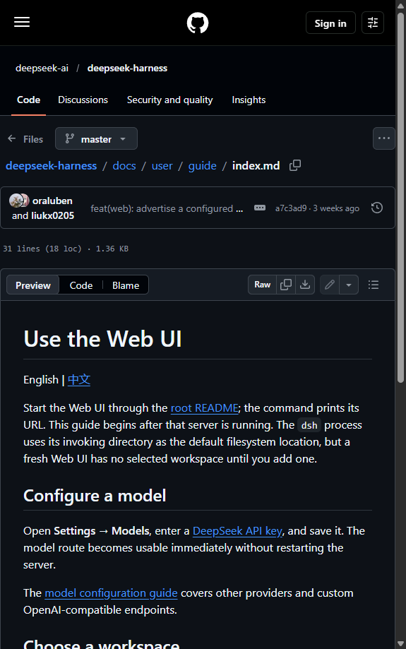

# Браузер агента для DeepSeek Harness

Настоящий Chromium в правой панели DSH: **свой у каждого чата**, с управлением
из инструментов агента. Пользователь и агент работают в одном и том же окне —
агент кликает, а вы видите результат и можете вмешаться.

- **Один чат — один браузер.** Открыли браузер в двух чатах — получили два
  независимых Chromium с разными cookie и разными логинами.
- **Два агента одновременно.** Каждый инструмент адресуется сессии своего
  агента, поэтому агенты не перехватывают команды друг друга.
- **Видно человеку.** Это не headless и не трансляция картинки: `<webview>`
  с нативной прокруткой, вводом и кликами.
- **Капчи решаются.** Есть настоящие события мыши Chromium и «человеческая»
  траектория перетаскивания для слайдер-пазлов.
- **Ставится в один клик** из списка плагинов DSH: плагин оформлен как бандл.

---

## Содержание

- [Как это выглядит](#как-это-выглядит)
- [Установка](#установка)
- [Инструменты агента](#инструменты-агента)
- [Настройка](#настройка)
- [Как это устроено](#как-это-устроено)
- [Чем отличается от MCP](#чем-отличается-от-mcp)
- [Безопасность](#безопасность)
- [Диагностика](#диагностика)
- [Разработка](#разработка)
- [Ограничения](#ограничения)

Дополнительно: [подробная установка](docs/install.md) ·
[история версий](CHANGELOG.md) ·
[как устроено внутри](docs/architecture.md) ·
[сравнение с MCP](docs/mcp-vs-plugin.md) ·
[как выложить свою версию](docs/publishing.md)

---

## Как это выглядит

В правой панели появляется вкладка «Браузер агента»: адресная строка, кнопки
навигации и сам сайт. В заголовке вкладки — имя открытой страницы, в адресной
строке справа — короткая подпись чата, чтобы не путать браузеры, когда их
открыто несколько.



```
┌──────────────────────────────────────────────┬───────────────────────────┐
│  Чат с агентом                               │ ← ↻ ⌂ [адрес]    чат 3f2a… │
│                                              │───────────────────────────│
│  Агент: открываю страницу и ищу товар…       │                           │
│                                              │      настоящий сайт       │
│                                              │      (Chromium)           │
└──────────────────────────────────────────────┴───────────────────────────┘
```

---

## Установка

### Способ 1: из списка плагинов (рекомендуется)

1. Откройте боковую панель DSH → **Plugins**.
2. Нажмите **Add plugin** и вставьте адрес репозитория:

   ```
   https://github.com/d3d-root/dsh-plugin-agent-browser
   ```

   Можно указать и **абсолютный путь** к скачанной папке плагина.
3. Включите плагин переключателем.
4. **Полностью перезапустите DSH** — выйдите из приложения и запустите заново.

Плагин объявляет `dsh.bundle.patch`, поэтому менеджер плагинов принимает его
как бандл и сам добавляет в `dsh.profile.bundles` профиля.

> **Почему нужен полный перезапуск.** Серверная половина плагина подхватывается
> на лету, а клиентская входит в сборку страницы только при её загрузке. Плагин
> сообщает об этом сам: через 7 секунд в правом нижнем углу появляется баннер с
> кнопкой «Перезагрузить», а `browser_status` прямо пишет, что делать. Если
> баннера нет — значит всё загрузилось.

### Способ 2: вручную, если UI не подходит

```powershell
$Dsh = "$env:LOCALAPPDATA\Programs\DeepSeek Harness\resources\runtime\cli\bin\dsh.cmd"

# 1) подключить пакет в профиль (профиль обычно desktop)
& $Dsh plugin --profile desktop add "github:d3d-root/dsh-plugin-agent-browser"

# 2) добавить "dsh-plugin-agent-browser" в dsh.profile.bundles
#    файла %USERPROFILE%\.dsh\profiles\desktop\package.json
#    (или просто включить плагин на странице Plugins)
```

Затем перезапустите DSH.

Подробная инструкция со всеми вариантами и разбором проблем —
в [`docs/install.md`](docs/install.md).

### Проверка, что всё встало

Спросите агента:

> открой example.com и покажи заголовок

Или проверьте журнал — в нём должна быть строка `клиент подключён: окон 1`:

```powershell
Get-Content "$env:TEMP\dsh-agent-browser.log" -Tail 5
```

### Обновление

Версию видно в `browser_status` (строка «Версия плагина») и в журнале.

Для установки из GitHub кнопки «Обновить» в интерфейсе нет — DSH показывает её
только для пакетов из npm. Обновление — одной командой, затем перезапуск DSH:

```powershell
$Dsh = "$env:LOCALAPPDATA\Programs\DeepSeek Harness\resources\runtime\cli\bin\dsh.cmd"
& $Dsh plugin --profile desktop add "github:d3d-root/dsh-plugin-agent-browser"
```

Команда сама переустановит плагин с последнего коммита и покажет смену версии.
Подробности и откат — в [`docs/install.md`](docs/install.md#обновление),
история версий — в [`CHANGELOG.md`](CHANGELOG.md).

---

## Инструменты агента

Плагин регистрирует 22 инструмента. Все они работают с браузером **того чата,
в котором вызваны**.

### Управление вкладкой

| Инструмент | Что делает |
|---|---|
| `browser_open` | открыть вкладку в этом чате (первый вызов) |
| `browser_reveal` | показать вкладку на экране, не меняя получателя команд |
| `browser_close` | закрыть вкладку этого чата |
| `browser_tabs` | список всех браузеров во всех чатах и какой из них ваш |
| `browser_status` | доступен ли браузер и какая страница открыта |

### Навигация и чтение

| Инструмент | Что делает |
|---|---|
| `browser_navigate` | открыть адрес, дождаться загрузки |
| `browser_read` | адрес, заголовок и видимый текст страницы |
| `browser_html` | HTML страницы (для разбора структуры) |
| `browser_eval` | выполнить JavaScript и вернуть результат |
| `browser_back` / `browser_forward` | назад / вперёд |
| `browser_reload` | обновить страницу |
| `browser_wait` | ждать селектор или текст (или просто пауза) |
| `browser_scroll` | прокрутить страницу |

### Действия

| Инструмент | Что делает |
|---|---|
| `browser_click` | клик по видимому тексту элемента |
| `browser_click_at` | клик в точке (синтетическое событие) |
| `browser_mouse_click` | клик настоящим событием Chromium |
| `browser_type` | ввести текст в поле, при желании отправить форму |
| `browser_key` | нажать клавишу (Enter, Escape, Tab, стрелки…) |

### Капчи и картинки

| Инструмент | Что делает |
|---|---|
| `browser_screenshot` | скриншот в PNG; дальше смотрите его через `read_image` |
| `browser_drag` | перетаскивание с человеческой траекторией (слайдер-пазлы) |
| `browser_set_ua` | подменить User-Agent на обычный Chrome |

> `browser_screenshot` пишет файл **только** в папку скриншотов и рабочий
> каталог сессии — см. [Безопасность](#безопасность).

---

## Настройка

Все поля необязательны. Правятся в `config` записи плагина (в профиле это
`cordis.patch.yml`, в UI — настройки плагина).

| Поле | По умолчанию | Смысл |
|---|---|---|
| `startUrl` | `https://www.google.com` | стартовая страница новой вкладки |
| `language` | `auto` | язык подписей: `auto`, `ru`, `en` |
| `focusOnOpen` | `true` | переключать чат на сессию агента при открытии браузера |
| `autoOpen` | `true` | открывать вкладку автоматически, если её нет |
| `userAgent` | Chrome 152 / Windows | UA для `browser_set_ua` |
| `timeoutMs` | `30000` | сколько ждать ответа браузера на команду |
| `openTimeoutMs` | `20000` | сколько ждать готовности только что открытой вкладки |
| `port` | `0` | порт резервного сервера (0 — любой свободный) |
| `debug` | `true` | писать отладочный журнал |
| `logFile` | временная папка | свой путь журнала |

Пример:

```yaml
- insert:
    - id: agent-browser
      name: dsh-plugin-agent-browser
      config:
        startUrl: https://duckduckgo.com
        language: ru
        focusOnOpen: false
```

---

## Как это устроено

Плагин состоит из трёх частей и одного общего моста.

```
┌──────────────────────────── DSH ────────────────────────────┐
│                                                             │
│  Хост (Node)                        Клиент (браузер)        │
│  ┌────────────────────┐             ┌─────────────────────┐  │
│  │ lib/index.js       │             │ lib/client.js       │  │
│  │ 22 инструмента     │             │ панель + сторож     │  │
│  └─────────┬──────────┘             └──────────┬──────────┘  │
│            │ HTTP                              │ HTTP        │
│            └──────────► lib/bridge.mjs ◄───────┘             │
│                        маршрутизация по сессии              │
│                              │                               │
│                    ┌─────────┴──────────┐                    │
│                    │ <webview> сессии A │  свой Chromium     │
│                    │ <webview> сессии B │  свой Chromium     │
│                    └────────────────────┘                    │
└─────────────────────────────────────────────────────────────┘
```

**Почему мост, а не прямой вызов.** Инструмент выполняется в хосте (Node), а
браузер живёт в окне (Chromium). Это разные процессы, поэтому между ними
нужен транспорт. Мост — тонкий маршрутизатор: он держит список панелей, знает
их сессии и передаёт команды длинным опросом.

**Транспорт.** Основной путь — маршрут `/dsh-agent-browser` на встроенном
веб-сервере DSH: тот же origin, что у страницы, никаких портов и CORS, два
окна DSH не конфликтуют. Если встроенного сервера нет (окно открыто через
`file://`), плагин поднимает собственный сервер на `127.0.0.1` и сообщает
клиенту адрес через `index.html`.

**Как инструмент узнаёт свой чат.** У каждого вызова инструмента есть
`exec.agent.id` — идентификатор сессии. Хост передаёт его мосту, мост выбирает
панель этой сессии. Поэтому два агента в разных чатах не мешают друг другу.

**Как открывается вкладка в фоне.** Вкладку можно создать только в сессии,
чей store правой панели уже создан, а создаётся он при показе чата. Поэтому
сторож открытия при необходимости переключает чат, открывает вкладку и, если
`focusOnOpen: false`, возвращает прежний чат.

**Почему у чатов разные профили.** Ключ аренды `<webview>` — это строка
workspace: один и тот же ключ даёт общий профиль Chromium, разные ключи —
изолированные. Плагин берёт ключ `dsh-agent-browser:<id сессии>`, поэтому у
каждого чата свои cookie и свои логины.

---

## Чем отличается от MCP

Оба способа дают агенту инструменты, но браузер живёт в разных местах.

| | Этот плагин | MCP-сервер (например, `@playwright/mcp`) |
|---|---|---|
| Где браузер | `<webview>` внутри DSH | отдельный процесс вне DSH |
| Видит ли человек | да, и может вмешаться | обычно да, но это чужое окно |
| Помочь с капчей | человек кликает в том же окне | только через отдельный Live View |
| Свой браузер на чат | да, из коробки | нужно поднимать отдельные контексты |
| Изоляция cookie | профиль на сессию | зависит от флагов сервера |
| Установка | плагин DSH | Node + браузер + конфиг MCP |
| Доступ к UI DSH | да (открыть панель, переключить чат) | нет |
| Стоимость контекста | 22 компактные схемы | свои схемы + большие снимки страниц |

**Когда MCP лучше:** нужна трассировка, PDF, мокинг сети, запись видео —
то, чего здесь нет; или браузер нужен не только DSH, но и другим клиентам.

**Когда этот плагин лучше:** нужен видимый человеку браузер, совместная работа
«агент + человек», несколько чатов с разными профилями, решение капч.

Подробный разбор с источниками — в [`docs/mcp-vs-plugin.md`](docs/mcp-vs-plugin.md).

---

## Безопасность

Что сделано, чтобы мост не стал дырой:

- **Только этот компьютер.** Маршрут отклоняет запросы, пришедшие не с
  loopback-адреса. Даже если DSH слушает сеть, мост снаружи недоступен.
- **Токен.** Каждый запуск генерирует случайный токен; он передаётся только в
  заголовке `x-agent-browser-token`. В строке запроса токена нет — иначе он
  попадал бы в журналы и историю.
- **Предел тела запроса** — 8 МБ. Иначе один запрос мог бы съесть память.
- **CORS не звёздочка.** Резервный сервер отвечает `access-control-allow-origin:
  null` (origin страницы на `file://`), а не `*`.
- **Запись скриншотов ограничена** папкой скриншотов и рабочим каталогом
  сессии: инструмент пишет файл напрямую, минуя файловую политику DSH, поэтому
  сам проверяет путь и не даёт перезаписать чужой файл.
- **Навигация только по http/https.** `<webview>` в DSH запрещает переходы на
  `file://` и другие схемы, а также на хост самого DSH.

Чего сознательно **нет**:

- Плагин не отключает проверки безопасности Electron: `nodeIntegration`,
  `contextIsolation`, `sandbox` остаются штатными.
- Инструмент `browser_eval` исполняет произвольный JS **на открытой странице**.
  Это его смысл, но помните: страница получает то, что вы ей передали, а
  ответ уходит модели.

---

## Диагностика

Журнал плагина:

```
%TEMP%\dsh-agent-browser.log
```

Что смотреть:

- `мост готов: http://…` — транспорт поднялся, адрес рабочий;
- `транспорт не поднялся: …` — обычно нет веб-сервера и занят порт;
- `панель подключилась: … (сессия …)` — браузер нашёл мост;
- `webview готов: … (чат …)` — Chromium запустился.

Частые проблемы:

| Симптом | Причина и что делать |
|---|---|
| «клиентская половина не загружена» | плагин включили уже после запуска приложения — перезапустите DSH целиком |
| Баннер в углу «Плагин загружен не полностью» | то же самое; в баннере есть кнопка «Перезагрузить» |
| «в этой сессии браузер не открыт» | вызовите `browser_open` |
| «браузер доступен только в приложении DSH» | открыто как веб-страница, а не в приложении |
| Всё было хорошо, потом перестало | перезапустите DSH: мост живёт в процессе |

> `Ctrl+R` помогает **не всегда**: Electron может отдать ту же закэшированную
> сборку. Надёжный способ — закрыть приложение и запустить заново.

### Почему иногда нужен перезапуск

Плагин состоит из двух половин: серверной (в процессе DSH) и клиентской (в
окне). Серверная подхватывается на лету, а клиентская входит в сборку страницы
только при её загрузке. Если включить плагин, не перезапуская приложение,
серверная половина уже работает, а клиентской в открытом окне ещё нет.

Плагин сообщает об этом сам, тремя способами:

- **баннером** в правом нижнем углу — он появляется через 7 секунд после
  загрузки окна, если клиентская половина не отметилась. В баннере есть кнопка
  «Перезагрузить» (быстрая попытка) и совет перезапустить приложение;
- **ответом инструментов** — `browser_status` различает «мост не поднялся» и
  «клиент не загружен» и пишет, что именно делать;
- **строкой в журнале** через 20 секунд после старта.

Клиент умеет забирать токен моста сам (через `/bootstrap`), поэтому рассинхрон
лечится перезапуском, а не переустановкой плагина.

---

## Разработка

```powershell
# тесты моста (без сети и без DSH)
npm test

# проверка синтаксиса
node --check lib/index.js
node --check lib/bridge.mjs
```

Структура:

```
lib/bridge.mjs    маршрутизация команд по сессиям, транспорт, лимиты
lib/index.js      хост: инструменты, конфиг, журнал, маршрут на веб-сервере
lib/client.js     клиент: панель <webview>, сторож открытия вкладок
test/             юнит-тесты моста (node:test)
docs/install.md   подробная установка и разбор проблем
docs/architecture.md  как устроено внутри
docs/mcp-vs-plugin.md сравнение с MCP-браузерами
docs/publishing.md    как выложить свою версию
```

Тесты покрывают именно то, что чаще всего ломается: маршрутизацию по сессиям,
выбор панели, длинный опрос, управляющие команды и защиту транспорта.

---

## Ограничения

- Нужно приложение DSH (Electron): в обычном браузере `<webview>` недоступен,
  и панель честно об этом скажет.
- Профили браузеров живут в памяти процесса: после перезапуска DSH cookie
  теряются. Это цена изоляции — см. `docs/architecture.md`.
- Одна вкладка на чат по умолчанию; несколько вкладок в одном чате возможны,
  но команды идут в видимую.
- `browser_screenshot` не умеет снимать всю страницу целиком — только
  видимую область или заданный прямоугольник.

---

## Лицензия

MIT — см. [LICENSE](LICENSE).
